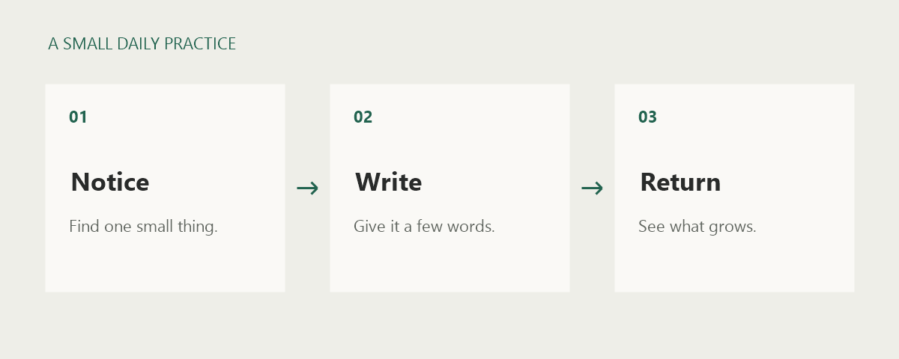

A notebook is useful when it is easy to open and easy to leave. These are the
habits I am trying this week:

- Give each note a title that I will recognize later.
- Keep one idea on each page.
- Link related thoughts instead of repeating them.

## A small routine

Set aside **five minutes** at the end of the day. Write what caught your attention
and one thing you would like to try next.



```text
Notice something.
Write it down.
Come back when you have more to say.
```

Some days a single sentence is enough. The useful part is having a place to put it.

## Keep a little code, too

A notebook can hold working ideas as well as words. Give a fenced code block a
language, such as `csharp`, to highlight it:

```csharp
var notes = new[] { "Notice something", "Write it down", "Return tomorrow" };

foreach (var note in notes)
{
    Console.WriteLine(note);
}
```
